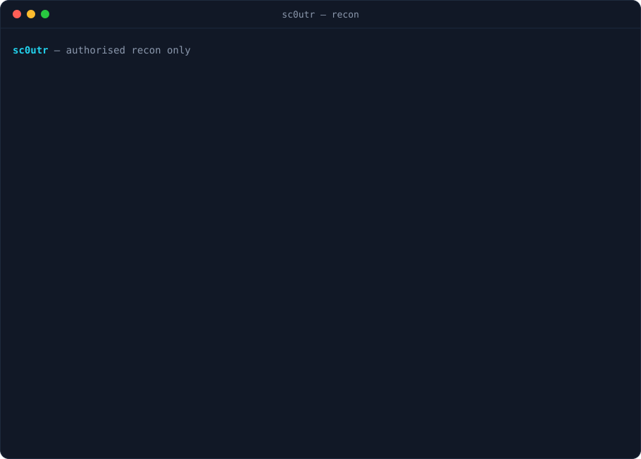

# sc0utr

[](https://github.com/grimh3xx/sc0utr/actions)
[](LICENSE)


**Agregador de recon em Rust para avaliações autorizadas.** Junta num só comando o
primeiro passo de todo engajamento — DNS (A/AAAA/MX/NS/TXT/SOA e PTR reverso),
brute de subdomínios, connect-scan de portas com banner e whois seguindo o
`refer:` do IANA — com **saída JSON limpa** pra pipar no `jq`/Elastic.

<p align="center"></p>

> ## ⚠️ Uso autorizado apenas
> Recon ativo (DNS brute, portscan) toca o alvo. Rode **somente** contra sistemas
> que você tem **permissão explícita** para testar. Uso não autorizado é crime; a
> responsabilidade é inteiramente sua.

## Módulos

| flag | o que faz |
|---|---|
| `--dns` | A/AAAA/MX/NS/TXT/SOA (ou PTR reverso se o alvo for IP) |
| `--subs` | brute de subdomínios (wordlist embutida ou `--wordlist`) |
| `--ports` | connect scan das portas comuns + banner (`--port-list` pra custom) |
| `--whois` | consulta porta 43 seguindo o `refer:` do IANA |
| `-A/--all` | tudo. Sem flags: `dns` + `whois` (rápido e não intrusivo) |

## Uso

```sh
sc0utr exemplo.com -A -o recon.json
sc0utr exemplo.com --subs --wordlist subs.txt -c 400
sc0utr 10.0.0.5 --ports --port-list 22,80,443,3389
```

Alvo aceita domínio ou IP. Concorrência com `-c`, timeout com `--timeout`.

## Build

```sh
cargo build --release
```

Regenerar o demo: `python3 tools/gen_demo.py`.

## Licença

MIT. Veja [LICENSE](LICENSE).
