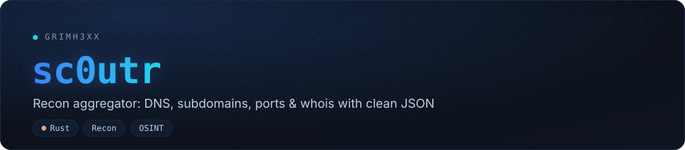

[](https://github.com/grimh3xx/sc0utr/actions)
[](LICENSE)


**Recon aggregator in Rust for authorised assessments.** The first step of every
engagement in one command — DNS (A/AAAA/MX/NS/TXT/SOA and reverse PTR), subdomain
brute force, connect-scan with banner grab, and whois following the IANA
`refer:` — with **clean JSON output** to pipe into `jq`/Elastic.

<p align="center"></p>

> ## ⚠️ Authorised use only
> Active recon (DNS brute, port scan) touches the target. Run **only** against
> systems you have explicit permission to test. You are responsible.

## Modules

| flag | what it does |
|---|---|
| `--dns` | A/AAAA/MX/NS/TXT/SOA (or reverse PTR when the target is an IP) |
| `--subs` | subdomain brute force (built-in wordlist or `--wordlist`) |
| `--ports` | connect scan of common ports + banner (`--port-list` for custom) |
| `--whois` | port-43 lookup following the IANA referral |
| `-A/--all` | everything. With no flags: `dns` + `whois` (fast, non-intrusive) |

## Usage

```sh
sc0utr example.com -A -o recon.json
sc0utr example.com --subs --wordlist subs.txt -c 400
sc0utr 10.0.0.5 --ports --port-list 22,80,443,3389
```

Target is a domain or an IP. `-c` sets concurrency, `--timeout` the per-op timeout.

## Tests

```sh
cargo test --release
```

## Build

```sh
cargo build --release
```

Regenerate the demo: `python3 tools/gen_demo.py`.

## License

MIT. See [LICENSE](LICENSE).
